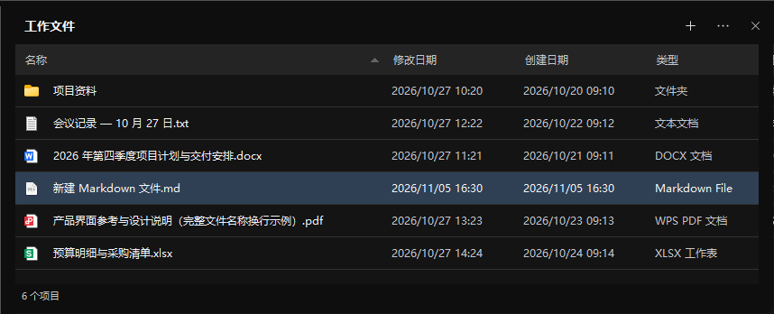

# 辛普莱特的万剑匣 · Symplatt

万剑匣是一款 Windows 11 x64 桌面收纳工具。把桌面项目放进半透明收纳盒后，可以在盒内打开、排序，也可以随时移回桌面。



## 下载与启动

从 [GitHub Releases](https://github.com/Symplatt/symplatt-swordbox/releases/latest) 下载 Windows x64 压缩包，解压后运行 `SwordBox.exe`。发行包自带 .NET 运行时。

在桌面空白处右键，选择「显示更多选项 → 新建 → 收纳盒」，或使用经典菜单里的「新建收纳盒」。运行程序会自动注册入口。也可以单独运行「注册桌面入口.cmd」。

升级时，从托盘退出旧版，再用新版覆盖程序目录。新版继续读取已有配置和收纳记录。

## 使用收纳盒

- **调整布局**　拖动标题栏移动盒子。拖动任意边或角时显示缩放轮廓，松开鼠标应用大小，按 Esc 取消。移动和缩放可吸附到相邻盒子或工作区边缘。
- **新建项目**　点击右上角的「+」，或右键盒内空白处。选择文件夹、文本文档、Markdown 文件或空白文件，输入名称即可。空白文件可以自定义扩展名，文件内容为空。
- **收纳已有文件**　从桌面拖入文件或文件夹，或点击「… → 收纳文件」批量选择。收纳盒支持直接位于桌面的文件系统项目。
- **打开和整理**　双击项目用默认应用打开。右键项目可以定位、复制路径或移出收纳。按 Delete 或右键「删除」可将所选项目移入回收站。单选后按 F2 可重命名。将选中项拖回桌面可移出收纳。将选中项拖到另一个盒子可以转移收纳关系。
- **排序和显示列**　点击列标题排序，右键属性列标题可隐藏该列，通过「… → 显示列」恢复。文件夹始终排在文件前面，可在「…」菜单中切换是否优先按类型排序。
- **关闭和恢复**　关闭盒子会把项目放回桌面，并保留清单和布局。可在托盘的「恢复已关闭的收纳盒」中重新打开。使用「… → 解散收纳盒」可移除盒子记录。

托盘菜单还可新建、隐藏、显示或刷新收纳盒。打开「设置」可以调整透明度和开机自启。

## 文件位置与恢复

收纳文件保留原桌面路径和属性。打开资源管理器的「桌面」，可以照常查看和编辑。万剑匣只在 Windows 桌面图标视图中隐藏已收纳项目的图标。移出、关闭盒子或退出后，图标恢复显示。万剑匣通过桌面窗口的绘制区域遮住对应图标，Windows 可以照常新建文件和编辑文件名。

配置和旧版恢复记录位于 `%LOCALAPPDATA%\Simplicit\SwordBox`。升级时会把旧版收纳目录中的文件放回桌面。遇到同名项目时，恢复文件名会加编号。文件被应用占用时，关闭该应用后可运行「恢复桌面图标.cmd」重试。

## 构建

需要 Windows x64 和 [.NET 10 SDK](https://dotnet.microsoft.com/download/dotnet/10.0)。项目使用 C#、WinForms 和 Win32 API，无第三方 NuGet 依赖。

```powershell
pwsh -File ./build.ps1
```

压缩包生成在 `dist/`。运行 `SwordBox.exe --sandbox <空测试目录> --self-test` 可检查收纳、保存与恢复流程。测试目录名称需包含 `sandbox`。

完整版本记录见 [CHANGELOG.md](CHANGELOG.md)。
